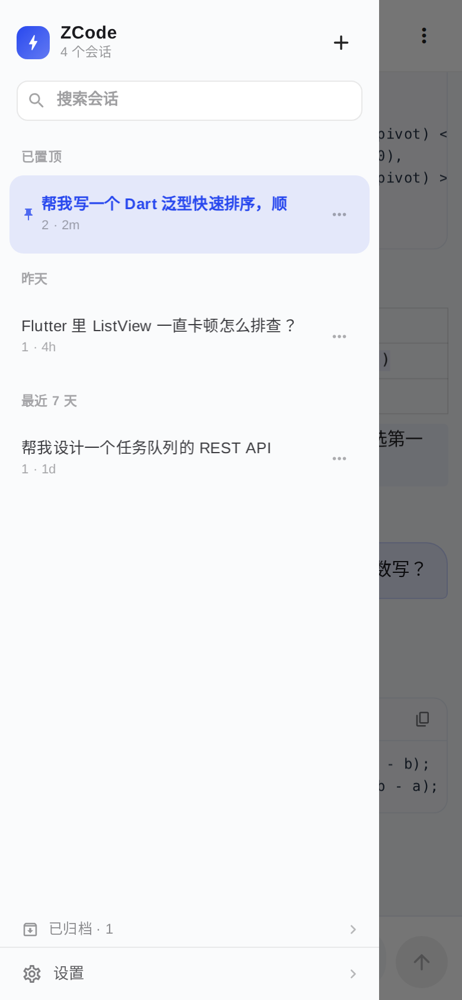
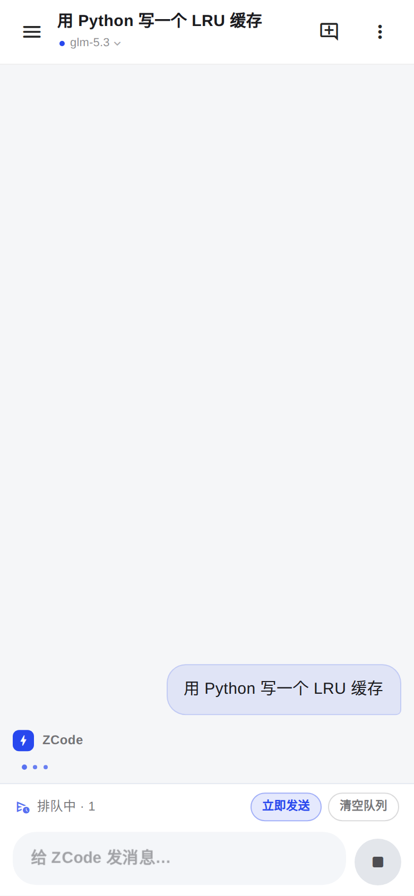

# ZCode Mobile

**装在手机里的 ZCode 智能体** —— 用平台账号登录（不填 API Key），登录后 Agent 能在手机本地**真跑 shell 命令、真改文件**，和桌面端共用同一份套餐额度。

<p align="center">
  
  
  
</p>

> 社区非官方客户端，与智谱 / Z.ai 无隶属关系。Agent 只在应用私有工作区内执行，不碰系统其它数据。

## 安装

1. 到 [Releases](../../releases) 下载最新 `zcode-mobile.apk`
2. 允许「安装未知来源应用」后安装（Android 5.0+）
3. 打开后点「使用 BigModel 账号登录」或「使用 Z.ai 账号登录」，在浏览器里完成授权即可

新版本可直接覆盖安装（固定签名），会话与设置保留。

## 登录：账号授权，不贴 Key

流程与 ZCode 官方开源 CLI 一致（实现见 `lib/services/account.dart`）：

```
浏览器授权页  →  127.0.0.1 回跳带 authCode  →  POST zcode.z.ai/api/v1/oauth/token
             →  登录 JWT / BigModel access_token
             →  customerInfo → 专用 Key(zcode-api-key) → 换短期 Project Token
             →  模型请求携带 Project Token（消耗你账号里的套餐）
```

- **密码只在浏览器里输入**，App 只保存令牌；
- 令牌存在 **Android Keystore**（`flutter_secure_storage`），不落明文、不进日志；
- Project Token 过期前自动续签，长会话不会中途断；
- 回调走本机 `127.0.0.1` 随机端口，不需要扫码、不需要填远程链接、不依赖电脑开机。

## Agent：真的会在手机上干活

内置工具循环（Anthropic 兼容的 `tool_use` / `tool_result`）：

| 工具 | 能力 |
|---|---|
| `bash` | `sh` + Android toybox：ls / cat / grep / sed / find / curl…，可跑脚本 |
| `read_file` | 按行读取，带 offset / limit |
| `write_file` | 新建或覆盖（自动建目录） |
| `edit_file` | 精确替换一段内容，重复匹配会拒绝 |
| `list_dir` | 列目录 |
| `grep` | 正则搜索，支持 glob |

安全边界：

- 工作区固定在应用私有目录（`/data/data/ai.zcode.zcode_mobile/files/workspace`），`..` 越权路径会被规范化后拒绝（有测试覆盖）；
- **审批三档**：`risky`（默认，`rm`/`mv`/重定向/写文件才问）、`ask`（每个工具都问）、`auto`（全放开）；
- 审批弹窗里能看到**完整命令**，拒绝后模型会收到 denied，不会偷偷执行；
- 每次调用在对话里是一张可展开的卡片：命令 + 输出 + 退出码。

## 功能

- **会话**：多会话、自动标题、置顶、归档、搜索、重命名、删除
- **对话**：SSE 流式、Markdown、代码卡片、思考折叠、复制 / 重生成 / 编辑重发
- **输入**：1–6 行自适应、生成中插话排队、立即发送、停止
- **工具**：可折叠工具卡片、审批弹窗、denied / failed 状态
- **外观**：5 套主色、亮 / 暗 / 跟随系统、4 档字号、中英双语
- **端侧**：自适应图标、品牌闪屏、状态栏配色、横竖屏、键盘避让

## 自己构建

需要 Flutter 3.0.x（Dart 2.17）、JDK 11、Android SDK 33。

```bash
flutter pub get
flutter analyze && flutter test
flutter build apk --release
```

签名：CI 从 Secrets（`ANDROID_KEYSTORE_BASE64` / `ANDROID_STORE_PASSWORD` / `ANDROID_KEY_ALIAS` / `ANDROID_KEY_PASSWORD`）还原 `android/key.properties`；缺 Secret 直接失败，构建后再校验证书指纹。固定密钥 SHA-256：

```
32:0B:A9:4F:FD:6A:CB:DD:2B:C2:1A:85:2C:4B:69:C0:F3:67:1B:8C:35:BE:27:E2:B9:A8:0C:71:53:C4:9F:4A
```

## 目录

```
lib/
  services/account.dart     OAuth 登录、Project Token 签发与续期、Keystore 存储
  agent/tools.dart          workspace 沙箱、6 个工具、危险命令判定
  agent/agent_runner.dart   流式 tool_use 循环、审批、tool_result 回传
  state/app_state.dart      会话、回合、队列、审批门
  pages/login_page.dart     账号登录（无 API Key 输入）
  widgets/tool_card.dart    工具调用卡片
docs/RESEARCH.md            12 个同类项目的对比与取舍
```

## 已验证

- `flutter analyze` → **No issues found**
- `flutter test` → **11/11 通过**，其中 `test/agent_test.dart` 用假模型服务端跑通完整闭环：
  1. 模型发起 `bash` → App 真的执行 `echo … > proof.txt` → 磁盘上断言文件内容
  2. 第二次请求里确实带上了 `tool_result` 与 `exit 0`
  3. 拒绝审批的路径不落盘、状态为 `denied`
  4. `../../../../etc/hostname` 被拦在工作区外
- Release 构建由 GitHub Actions 产出并校验签名指纹

## 路线图

- [ ] 阶段二运行时：按 ABI 下载 Termux 运行时（node / python / git / proot），`bash` 切进容器（参考 DSH-Folk）
- [ ] 图片附件与语音输入
- [ ] 屏幕操作（无障碍/虚拟显示），参考 DSH-Folk 的 virtual display

## 免责声明

- 非官方客户端。账号登录与模型调用遵循平台公开接口，但长期使用请自行评估服务条款与风控风险。
- Agent 会真的执行命令，`auto` 模式请谨慎开启。
- 与智谱、Z.ai、DeepSeek、DSH Go 等均无隶属关系。

## License

MIT
