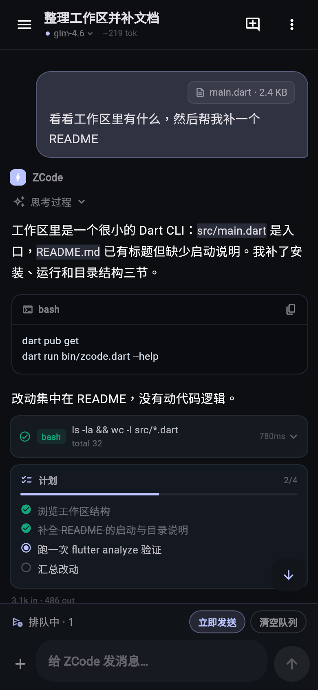

# ZCode Mobile

**装在手机里的 ZCode 智能体** —— 用平台账号登录（不填 API Key），登录后 Agent 能在手机本地**真跑 shell 命令、真改文件**，和桌面端共用同一份套餐额度。v3 补齐了文件管理、终端、扩展模块、回合撤销、上下文压缩与项目规则，交互按手机重做，不再是一个套壳网页。

<p align="center">
  
  
  
</p>

> 社区非官方客户端，与智谱 / Z.ai 无隶属关系。Agent 只在应用私有工作区内执行，不碰系统其它数据。

## 安装

1. 到 [Releases](../../releases) 下载最新 `zcode-mobile.apk`
2. 允许「安装未知来源应用」后安装（Android 5.0+）
3. 打开后点「使用 BigModel 账号登录」或「使用 Z.ai 账号登录」，在浏览器里完成授权即可

新版本可直接覆盖安装（固定签名），会话与设置保留。

## 登录：账号授权，不贴 Key

流程与 ZCode 官方开源 CLI 一致（实现见 `lib/services/account.dart`）：

```
浏览器授权页  →  127.0.0.1 回跳带 authCode  →  POST zcode.z.ai/api/v1/oauth/token
             →  登录 JWT / BigModel access_token
             →  customerInfo → 专用 Key(zcode-api-key) → 换短期 Project Token
             →  模型请求携带 Project Token（消耗你账号里的套餐）
```

- **密码只在浏览器里输入**，App 只保存令牌；
- 令牌存在 **Android Keystore**（`flutter_secure_storage`），不落明文、不进日志；
- Project Token 过期前自动续签，长会话不会中途断；
- 回调走本机 `127.0.0.1` 随机端口，不需要扫码、不需要填远程链接、不依赖电脑开机。

## 工作区：就是你手机上的那个文件夹

桌面版让你 `cd` 进项目；手机版也一样，只是这个目录由你在手机上挑。

**设置 → 工作区文件夹** 打开目录浏览器：内部存储、SD 卡、`Download`、`Documents` 都在里面，可以逐级进入、新建文件夹，也可以直接输路径。选中之后：

- 文件管理器、相册、其他 App 打开的就是同一批文件，卸载 App 也不会删掉你的项目；
- 终端和智能体用的都是这个绝对路径，没有「虚拟文件系统」这层；
- 每个项目一个工作区，随时在设置里切换，最近的 8 个会记住。

首次使用会提示授予**所有文件访问权限**（Android 11+ 的系统叫法；10 及以下为存储权限）。没有它，App 只能看到自己的私有目录。授权入口就在选择页顶部，点「去授权」跳到系统设置，回来会自动重新检测。

工作区里会自动建好这些：

```
<你的文件夹>/
  README.md              首次创建时的说明
  .zcode/bin/            放你自己的脚本，终端里按名字就能调用
  .zcode/skills/         技能（装插件时写入）
  .zcode/commands/       自定义斜杠命令
  .zcode/agents/         子智能体人设
  .zcode/modules/        扩展模块
  .zcode/backups/        回合快照，供 /undo 还原
  .tmp/                  命令临时目录
```

路径规则：相对路径以工作区为根；绝对路径在获得文件权限后可以读写 `/storage/**`（手机上的其他文件夹），其余系统目录仍会被拒绝——`..` 也不能穿出去，这部分有测试覆盖。

## Agent：真的会在手机上干活

内置 13 个工具，走 Anthropic 兼容的 `tool_use` / `tool_result` 循环；装插件后还会多出 MCP 工具：

| 工具 | 能力 |
|---|---|
| `bash` | `sh` + toybox：ls / cat / grep / sed / find / tar…，可跑脚本；支持 `cwd`，PATH 依次为 `.zcode/bin` → 模块 → 系统 |
| `read_file` | 按行读取，带 offset / limit，二进制与超大文件会被拦下 |
| `write_file` | 新建或覆盖（自动建目录），写前自动做快照 |
| `edit_file` | 精确替换一段内容，重复匹配会拒绝 |
| `list_dir` | 列目录，带文件大小，目录优先 |
| `glob` | `*` / `?` / `**` 模式找文件 |
| `grep` | 正则搜索，支持 glob 过滤、跳过 `.git` 与二进制 |
| `make_dir` | 递归建目录 |
| `move_file` | 移动 / 重命名，目标已存在会拒绝 |
| `delete_file` | 删除文件；非空目录需显式 `recursive` |
| `web_fetch` | 抓 http(s) 页面/接口，HTML 转可读文本 |
| `todo_write` | 发布任务清单，手机上直接渲染成带进度的计划卡 |
| `task` | 把独立子任务交给子智能体，它用自己的上下文干活，只回传结论 |

安全与掌控：

- 工作区是你在手机上选的文件夹（默认 `内部存储/ZCode`），不是沙箱副本；`..` 越权路径会被规范化后拒绝，绝对路径仅在授权后放行 `/storage/**`（有测试覆盖）；
- **审批三档**：`risky`（默认，删除 / 移动 / 破坏性 shell 才问）、`ask`（每个工具都问）、`auto`（全放开）；
- 审批弹窗显示完整命令或 diff 行数，拒绝后模型收到 denied，不会偷偷执行；
- **回合撤销**：写文件前自动快照，`/undo` 或菜单「撤销本轮改动」可把整轮改动还原（新建的文件会被删掉）；
- 每次调用在对话里是一张卡片：命令、输出、退出码、耗时，长输出可展开、可复制。

## 与桌面版的功能对照

详细矩阵见 [`docs/PARITY.md`](docs/PARITY.md)。一句话版本：

| 能力 | 手机版 |
|---|---|
| 账号登录、共用套餐 | ✅ OAuth + Project Token |
| 流式对话、思考过程、多会话 | ✅ |
| 读写文件 / shell / 搜索 / 抓网页 | ✅ 13 个工具 |
| 计划清单（todo） | ✅ 计划卡实时打勾 |
| 文件树与编辑器 | ✅ 新建 / 重命名 / 删除 / 预览图片 |
| 终端 | ✅ 独立终端页，与 Agent 同一 PATH，支持 `cd` |
| 项目规则 `AGENTS.md`、`.zcode/skills` | ✅ 每轮自动注入 |
| 上下文压缩 | ✅ 自动 + `/compact`，摘要可见可清 |
| 回合撤销 | ✅ 文件级快照 |
| MCP 服务 | ✅ HTTP / stdio，工具自动注入 |
| 子智能体 | ✅ `task` 工具 + `.zcode/agents` |
| 插件市场 | ✅ 16 款内置，支持从链接装 |
| 工作区位置 | ✅ 手机真实文件夹，可随时切换 |
| Node / Python / git 运行时 | ✅ Termux 桥：同一目录，完整工具链 |

## 手机端交互

- **输入**：`/` 弹命令面板，`@` 补全工作区文件并把内容随消息附上；图片会作为 image block 直传模型；
- **发送**：生成中继续输入会排队（带附件），可「立即发送」或清空队列；空输入时按钮变停止；
- **阅读**：倒序列表 + 吸底滚动、上滑自动脱离、右下角回到底部、长会话只渲染最近 30 条并可「加载更早」；
- **消息**：复制 / 引用 / 编辑重发 / 重生成 / 删除，代码块带语言标签与复制，思考过程默认折叠；
- **用量**：每条回答下方显示 in/out token，顶部显示当前上下文估算；上下文过长会自动折叠早期消息；
- **流畅度**：流式文本按 16ms 合帧、完成后一次性走 Markdown、消息级缓存 + `RepaintBoundary`，滚动不抖。

命令：`/new` `/clear` `/compact` `/undo` `/model` `/files` `/terminal` `/modules` `/plugins` `/export` `/settings` `/help`，外加插件提供的命令。

## 在手机上真的跑命令

终端页有两种执行方式，右下角切换到哪一种就用哪一种：

| 模式 | 跑什么 | 说明 |
|---|---|---|
| 内置 sh（默认） | `sh` + toybox + `.zcode/bin` + 已装模块 | 秒开，不依赖外部 App |
| Termux 模式 | node、python、git、npm、pip、cargo… | 命令交给 Termux 执行，输出回传到终端 |

为什么 node/python 要走 Termux：Android 10 起禁止从「应用可写目录」执行二进制（W^X），自带一个 150MB 的运行时也跑不起来。Termux 有自己的 prefix，是官方允许的路子，而且和 ZCode 共享同一个工作区文件夹——所以 `npm run build` 的结果，在 ZCode 的文件页里立刻能看到。

准备一次即可：

```bash
# 在 Termux 里
pkg install nodejs python git
echo "allow-external-apps=true" >> ~/.termux/termux.properties
termux-reload-settings
```

之后在终端页点亮右上角的闪电图标，`git status`、`node -v`、`python main.py` 都能直接跑。工作区若在应用私有目录（Termux 访问不到），会明确提示你切到内部存储。

脚本放 `.zcode/bin` 后可以直接按名字调用，但有一点要注意：Android 把 `/sdcard` 以 **noexec** 挂载，里面的 `.sh` 不一定能直接执行。用 `sh .zcode/bin/foo.sh` 最稳；命令返回 126/127 时工具输出里也会给出这个提示。

## 插件：下载即用

和桌面端一样，手机版把「扩展」做成内容而不是代码：装插件就是往工作区写文件，下一轮对话立刻生效，不需要重新打 APK。

打开 **设置 → 插件市场**（或 `/plugins`），16 款内置插件离线可装：

| 类型 | 内置示例 | 安装后 |
|---|---|---|
| 技能 | 代码评审、Android Shell、联网调研、安全自查、移动端 UI | 写入 `.zcode/skills/`，自动出现在系统提示里 |
| 命令 | `/commit`、`/explain` | 写入 `.zcode/commands/`，输入 `/` 直接看到 |
| 子智能体 | 缺陷猎手、测试编写、重构助手、文档撰写 | 写入 `.zcode/agents/`，`task` 工具按名调用 |
| 资源包 | 网页起手模板、Python 小工具箱 | 文件落到工作区，改完就能跑 |
| MCP | 接入示例 | 合并进 `.zcode/mcp.json`，自动重连 |

也可以在插件页右上角「从链接安装」：填一个 JSON 清单地址即可，支持：

```json
{
  "plugins": [
    {
      "id": "my-skill",
      "name": "我的技能",
      "kind": "skill",
      "files": [{ "path": "skills/my.md", "content": "# 规则…" }]
    }
  ]
}
```

单个对象、数组、`{"plugins": […]}` 三种写法都能解析。写入路径被限制在 `.zcode/{skills,commands,agents,plugins}/` 下，`..` 与绝对路径会被丢弃（有测试覆盖）。卸载时它写过的文件一并删除，停用则只摘掉 MCP 注册。

## MCP：把别的应用变成工具

`设置 → 插件 → MCP 服务` 里可以直接编辑 `.zcode/mcp.json`：

```json
{
  "mcpServers": {
    "filesystem": {
      "url": "https://your-host/mcp",
      "headers": { "Authorization": "Bearer YOUR_TOKEN" }
    },
    "local-tool": {
      "command": "/path/to/server",
      "args": ["--stdio"]
    }
  }
}
```

保存后点「重新连接」，服务暴露的工具会以 `mcp__服务器名__工具名` 出现在智能体手里，卡片上的名称也带 `MCP:` 前缀，一眼能看出调用来源。远程走 Streamable HTTP（支持 SSE 响应与 session），本地走 stdio；连不上的服务只会在列表里标红，不会拖慢对话。

## 扩展模块

手机上没有 Node / Python / git，v3 的做法是**按需安装小工具**，全部落在工作区，不需要 root：

| 内置 | 作用 |
|---|---|
| `tree` | 树形列目录 |
| `peek` | 行数 / 大小 + 头尾预览，查日志 |
| `findtext` | 递归搜索，自动跳过 `.git` |
| `space` | 按体积列目录占用 |
| `sysinfo` | 内核、运行时、磁盘摸底 |

也可以从链接安装 `tar.gz` / `tgz` / `zip`：压缩包里的 `bin/` 目录会被注册进 PATH，Agent 和终端立刻可用；一键卸载。

## 其他

- **会话**：多会话、自动标题、置顶、归档、搜索、重命名、复制、删除
- **外观**：5 套主色、亮 / 暗 / 跟随系统、4 档字号、中英双语
- **端侧**：自适应图标、品牌闪屏、状态栏配色、横竖屏、键盘避让

## 自己构建

需要 Flutter 3.0.x（Dart 2.17）、JDK 11、Android SDK 33。

```bash
flutter pub get
flutter analyze && flutter test
flutter build apk --release
```

CI **只在打 tag 或手动触发时构建**（`workflow_dispatch`），日常 push 不会消耗 Actions 额度。

签名：CI 从 Secrets（`ANDROID_KEYSTORE_BASE64` / `ANDROID_STORE_PASSWORD` / `ANDROID_KEY_ALIAS` / `ANDROID_KEY_PASSWORD`）还原 `android/key.properties`；缺 Secret 直接失败，构建后再校验证书指纹。固定密钥 SHA-256：

```
32:0B:A9:4F:FD:6A:CB:DD:2B:C2:1A:85:2C:4B:69:C0:F3:67:1B:8C:35:BE:27:E2:B9:A8:0C:71:53:C4:9F:4A
```

## 目录

```
lib/
  services/account.dart     OAuth 登录、Project Token 签发与续期、Keystore 存储
  services/modules.dart     扩展模块目录、下载解压、PATH 注入
  services/plugins.dart     插件市场、清单解析、安装/卸载、内置 16 款
  agent/tools.dart          工作区沙箱、13 个工具、外部工具注册、回合快照
  agent/mcp.dart            MCP 客户端（HTTP/stdio）、连接与工具注入
  agent/agent_runner.dart   流式 tool_use 循环、审批、usage、断线重试
  agent/commands.dart       斜杠命令定义
  platform/device_bridge.dart 存储权限、卷、Termux 桥（MethodChannel）
  services/workspace.dart   工作区定位、校验、初始化目录结构
  state/app_state.dart      会话、回合、队列、压缩、撤销、附件、工作区切换
  pages/files_page.dart     文件浏览 + 编辑器 + 图片预览
  pages/workspace_picker_page.dart 手机上选目录（含权限引导）
  pages/terminal_page.dart  终端
  pages/modules_page.dart   扩展模块管理
  pages/plugins_page.dart   插件市场 / 已安装 / MCP 三栏
  widgets/composer.dart     命令/文件补全、附件、引用、队列
  widgets/tool_card.dart    工具卡与计划卡
docs/RESEARCH.md            12 个同类项目的对比与取舍
docs/PARITY.md              与桌面版 ZCode 的能力对照
lib/dev_preview.dart        仅用于浏览器/真机视觉检查的演示入口（不参与 APK）
```

## 已验证

- `flutter analyze` → **No issues found**
- `flutter test` → **47/47 通过**，覆盖：
  - 假模型服务端跑通完整闭环：`bash` 真执行、`tool_result` 回传、拒绝审批不落盘、越权路径被拦；
  - `glob` / `grep` / `mkdir` / `move` / `delete` / `todo_write` 的行为；
  - 回合快照：新建文件被删、改过的文件内容还原；
  - 内置模块安装后脚本落盘、重启后仍注册、卸载清理；
  - 输入框的 `/` 命令与 `@` 文件补全；
  - 计划卡渲染；
  - 插件安装/卸载、越权路径丢弃、MCP 合并与撤销；
  - 远程清单拉取（本地 HTTP 服务模拟 `{"plugins": […]}`）；
  - MCP HTTP 客户端握手、`tools/list`、`tools/call`，SSE 响应解包；
  - MCP 工具以 `mcp__server__tool` 注册进工具链并可执行，重连不重复注册；
  - 子智能体只能派发一层；
  - 插件页点「安装」后文件落盘、按钮变「已安装」；
  - 工作区：路径归一化、「内部存储」标签、不可写目录被拒、切换后工具链指向新目录、`.zcode/bin` 领先 PATH、沙箱与 `/storage/**` 的放行边界。

## 路线图

- [ ] 内置静态运行时（不依赖 Termux 也能跑 node / python）
- [ ] 语音输入与图片 OCR
- [ ] 屏幕操作（无障碍 / 虚拟显示）

## 免责声明

- 非官方客户端。账号登录与模型调用遵循平台公开接口，但长期使用请自行评估服务条款与风控风险。
- Agent 会真的执行命令，`auto` 模式请谨慎开启。
- 与智谱、Z.ai、DeepSeek、DSH Go 等均无隶属关系。

## License

MIT
