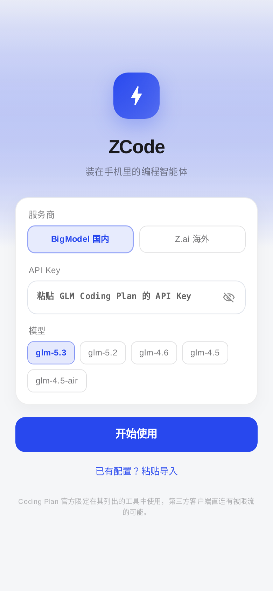
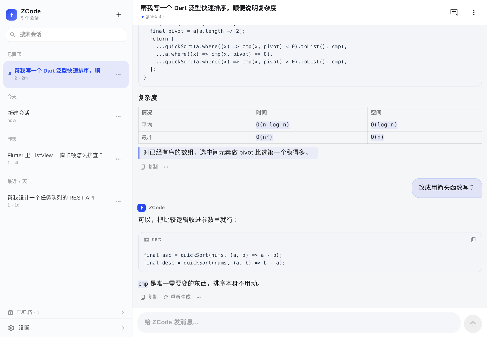

# ZCode Mobile

**装在手机里的 ZCode** —— 直连 GLM Coding Plan 的原生客户端，一套 Flutter 代码同时产出 **Android APK** 和 **Web / PWA**，与桌面端共用同一份 Token 与额度。

<p align="center">
  
  
  
  
</p>

> 社区非官方客户端，与智谱 / Z.ai 无隶属关系。仅直连官方 API，不代理、不上传任何中转数据。

---

## 为什么是这种形态

参考了 [DSH Go](https://github.com/ccch1mneyyy/dsh-Go)（DeepSeek Harness 的手机端）的产品结构，取了它对移动端最关键的三件事：

| 借鉴点 | 在 ZCode Mobile 的落地 |
|---|---|
| **原生 UI + 网页版共存** | 同一套 `lib/` 编译成 Android 原生渲染与 Web 静态站，存储层同为「一份 JSON」，两端数据模型完全一致 |
| **单键输入、生成中可插话** | 输入框只有一颗键：空输入时是停止，有输入时是发送；生成中发送进入**队列**，回合结束自动续发，也可「立即发送」打断 |
| **会话抽屉 + 自适应外壳** | 手机是左滑抽屉，平板/横屏/浏览器是常驻侧栏 + 居中内容，断点 780dp |

**没有照搬的地方**：DSH Go 在手机里内置了 PRoot + Ubuntu + Node 去跑完整 DSH 引擎（约 1 GB，Android only）。ZCode Mobile 走的是轻客户端路线，直连 Anthropic 兼容端点，包体 20 MB 左右、iOS 也能跑。代价是本地工具链（读写文件、跑命令）不在本期范围内，见「路线图」。

## 共享 Token

这是本项目的核心目标：**手机上不用重新登录、不用重复订阅，和桌面端吃同一份额度。**

三种方式，任选：

1. **直接填 Key** —— GLM Coding Plan 的 API Key 本身就是通用 Key，手机端填进去即可直连。桌面端 `~/.zcode/v2/config.json` 里的 `provider["builtin:bigmodel-coding-plan"].options.apiKey` 就是它。
2. **配置串导入** —— 设置 → 数据 → 导出配置，得到 `zcm://...` 一段文本；在另一台设备（包括浏览器版）粘贴导入，端点、模型、Key 一次带过去。设置里的外观项不会被覆盖。
3. **浏览器同源** —— Web 版把配置写进 `localStorage`，同一台电脑刷新即恢复，不依赖桌面客户端在跑。

```
设置 → 数据 → 导出配置  →  zcm://eyJ2IjoxLCJwcm92...
另一台设备 → 导入配置   →  粘贴 → 完成
```

## 功能

- **会话管理**：多会话、自动标题、置顶、归档、搜索、重命名、删除；按今天 / 昨天 / 最近 7 天 / 更早分组
- **对话**：SSE 流式、Markdown、代码卡片（语言标签 + 一键复制 + 横向滚动）、表格、引用、思考过程折叠
- **消息操作**：复制、重新生成、编辑并重发、删除单条；长按出操作面板
- **输入**：1–6 行自适应、桌面 Enter 发送 / Shift+Enter 换行、生成中插话排队、立即发送、清空队列
- **外观**：5 套主色、亮 / 暗 / 跟随系统、4 档字号、中英双语
- **自适应**：手机抽屉、平板侧栏、浏览器居中，同一份代码
- **数据**：全部本地存储；支持导出 Markdown 转录、导出/导入配置、一键清空
- **PWA**：Web 版可「添加到主屏幕」，独立窗口、自定义主题色

## 快速开始

### 直接跑 Web 版

```bash
cd zcode-mobile
flutter pub get
flutter run -d chrome            # 开发
flutter build web --release --web-renderer html
# 产物在 build/web，任意静态服务器即可
```

### 打 Android 包

```bash
flutter build apk --release
# 产物：build/app/outputs/flutter-apk/app-release.apk
```

> release 默认沿用 debug 签名（可直接安装，不能覆盖不同签名的包）。要发布请自行配置 `android/key.properties`。
> 首次安装后，在配置页填 Key，或从桌面端导出配置串粘贴导入。

### 用 GitHub Actions 构建

推送到 `main` 后，`.github/workflows/build.yml` 会：

1. `flutter analyze` + `flutter test`
2. 构建 Web（`--base-href /<仓库名>/`）并上传 artifact
3. 构建 `app-release.apk` 并上传 artifact
4. 若仓库启用了 Pages（Settings → Pages → Source: GitHub Actions），自动部署 Web 版

工具链固定在 **Flutter 3.0.0 / Dart 2.17**（与 `pubspec.yaml` 的约束一致），避免新版 SDK 的 API 漂移。

## 目录

```
lib/
  main.dart                 应用入口、主题装配、首次配置路由
  models/                   AppConfig / Conversation / ChatMessage
  services/                 GLM 流式客户端、SharedPreferences 存储
  state/app_state.dart      会话、流式回合、队列、持久化
  theme/app_theme.dart      亮/暗主题、5 套主色、字号缩放
  l10n/strings.dart         中英双语文案表
  pages/                    setup / home_shell / chat / sessions_drawer / settings
  widgets/                  composer / message_bubble / markdown_text
test/                       SSE 解析、思考流、错误处理、配置串、Markdown 导出、UI 冒烟
```

## 已验证

- `flutter analyze` → **No issues found**
- `flutter test` → **7/7 通过**（SSE 文本与思维流分离、401 处理、`zcm://` 往返、会话导出、配置页中英渲染）
- 真实浏览器 390×844 / 1180×820 两档视口截图核对：无溢出、无裁切
- 用本地 mock SSE 服务跑通完整链路：发送 → 流式 → 插话排队 → 回合结束自动续发 → Markdown 渲染

## 路线图

- [ ] 图片附件与从相册粘贴
- [ ] 语音输入
- [ ] 多模型供应商（OpenAI 兼容端点）
- [ ] 阶段二：内置工具链（读写文件、执行命令），对齐 ZCode 的 Agent 能力，需要内置 Node 运行时

## 免责声明

- GLM Coding Plan 的服务条款限定其用于官方列出的工具与产品环境。第三方客户端直连在技术上可行，但长期可能被限流或触发风控，**自用风险自负**。
- AI 输出可能出错，代码与命令请自行核验；涉及数据、账号、资金的操作不要无人值守地交给模型。
- 本项目与智谱、Z.ai、DeepSeek、DSH Go 均无隶属关系，也未使用其品牌素材。

## License

MIT
